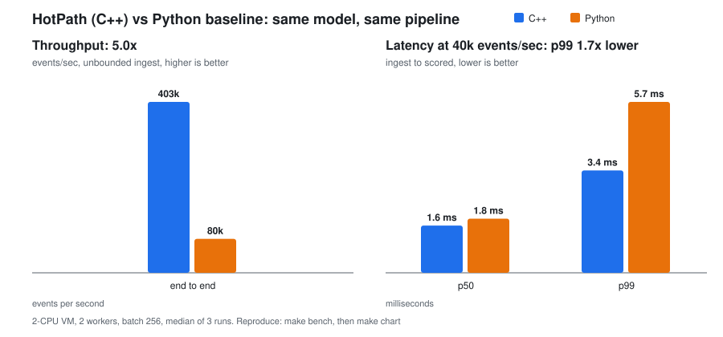

# HotPath: C++ Streaming Inference Engine for Event Data

A high-throughput C++20 service that scores a live event stream with an ML anomaly model (an isolation
forest exported to ONNX) and forwards the anomalies to a Splunk HEC-style endpoint, benchmarked against an
equivalent Python service.



Same model, same pipeline stages, same batch size and worker count; measured on a 2-vCPU VM
([method and caveats](#benchmarks); regenerate with `make bench && make chart`). Run-to-run variance is real: across
my runs C++ throughput ranged ~403k-425k events/s and the Python baseline's paced p99 ranged 5.7-10.3 ms.

| | C++ (HotPath) | Python baseline | |
|---|---|---|---|
| Max throughput, end to end | **403k events/s** | 80k events/s | 5.0x |
| p99 latency at 40k events/s | **3.4 ms** | 5.7 ms | 1.7x lower |

## Design note: memory and concurrency

- **No allocation on the hot path.** All micro-batches come from one aligned slab allocated at start-up
  (`BatchPool`). Batches circulate between a lock-free free list and the pipeline and are never freed. Feature rows are
  stored in exactly the layout ONNX Runtime expects, so inference reads them in place and writes scores into a
  per-worker buffer allocated once.
- **Queue type matches the thread topology.** Ingest to batcher has one producer and one consumer, so it uses a
  wait-free SPSC ring (head and tail on separate cache lines, each side caching the other's index). Batch fan-out to N workers,
  alert fan-in to the sink and the pool free list are MPMC (bounded Vyukov sequence-stamped queue). Both are lock-free and are
  tested for exactly-once delivery under contention and run clean under ThreadSanitizer.
- **Back-pressure instead of unbounded buffers.** Every queue is bounded. When the pool is exhausted the batcher waits, the
  ring fills, and the producer either blocks (`block`, for sustainable-throughput measurement) or drops with a counter
  (`drop`, for socket ingest). Shutdown drains stage by stage, so a finite run scores every event exactly once.
- **Contention-free metrics.** Each worker records latency into its own atomic log-linear histogram, merged only on
  scrape.
- **Where the speedup comes from:** raw ONNX scoring is nearly identical in both languages at batch 256 (234k vs 221k
  rows/s). The gain is everything around the model: per-event handling, hand-offs, batch assembly, and Python's GIL. Fusing the
  forest into one ONNX `TreeEnsembleRegressor` (instead of skl2onnx's ~3,000-node graph) gave an 8x scoring speedup found
  with Google Benchmark. The full rationale is in [Key design decisions](#key-design-decisions).

## CV line

> Built a C++20/ONNX streaming inference engine (lock-free queues, pre-allocated batch pool) processing 0.4M events/sec
> on a 2-vCPU VM, 5x faster than the Python baseline, with a Helm chart for kind/Kubernetes.

The throughput figure was measured locally (`make bench`), **not** inside kind. After running `make kind-up` and
`make demo`, you can read the in-cluster rate off the live view and, if you want "on kind" attached to the number, replace it with that figure.

## Demo (45-second terminal recording)

`scripts/demo.sh` is the script for the recording: `helm upgrade --install` onto kind, the pods coming up, a live metrics
view at the baseline rate (5k events/s), then the load generator ramped to unthrottled with the live view still running
(events/s, anomalies/s, alerts/s, p99, ring depth, pool occupancy, drops), and finally the alerts that reached the mock HEC.

```bash
make kind-up                                   # once: build images, create cluster
asciinema rec -c scripts/demo.sh demo.cast     # or just: make demo
python scripts/live_metrics.py                 # the live view on its own, against any :9100 endpoint
```

The recording itself is not checked in, and the kind flow has not been run in the environment this project was written in
(`live_metrics.py` was tested against a local run).

## Features

- **Model**: `python/hotpath/train.py` trains a scikit-learn `IsolationForest` on synthetic telemetry and exports a
  fused ONNX graph (`models/anomaly.onnx` plus `anomaly.meta` holding the calibrated alert threshold).
- **Pipeline**: ingest → batch → inference → sink on dedicated threads, joined by a lock-free SPSC ring and
  lock-free MPMC queues. Micro-batches live in a **pre-allocated memory pool** and are recycled, so the hot path never
  calls `malloc`.
- **Ingest sources**: an in-process synthetic generator (paced or unbounded) or a newline-delimited TCP listener.
- **Sink**: anomalies are POSTed as Splunk HEC JSON (many events per request, keep-alive, retry with backoff) to
  any HEC-compatible endpoint. A mock receiver ships in the repo.
- **Observability**: Prometheus `/metrics` (counters, queue and pool gauges, latency and inference histograms),
  `/healthz`, `/readyz`.
- **Benchmarks**: Google Benchmark micro-benchmarks, plus `bench/compare.py` running C++ and Python through the same
  pipeline.
- **Deployment**: multi-stage Dockerfile, `docker-compose.yml`, Helm chart, and kind scripts.

## Architecture

```
 synthetic gen / TCP lines
          │  (1 producer thread)
          ▼
   ┌──────────────┐  SPSC ring   ┌─────────┐  MPMC queue   ┌───────────────┐  MPMC queue   ┌──────────┐
   │ ingest source├─────────────►│ batcher ├──────────────►│ N inference   ├──────────────►│ HEC sink ├──► HTTP POST
   └──────────────┘  Event (56B) └────┬────┘  Batch*       │ workers (ONNX)│  Alert (64B)  └──────────┘   (HEC JSON)
                                      │ ▲                  └──────┬────────┘
                              acquire │ │ release                 │
                                      ▼ │                         ▼
                                 ┌──────────────┐          Prometheus /metrics
                                 │  BatchPool   │          (per-worker histograms)
                                 │ (one slab)   │
                                 └──────────────┘
```

| Stage | File | Notes |
|---|---|---|
| Ring buffer | `include/hotpath/spsc_ring.hpp` | wait-free, cached head/tail indices, one cache line per side |
| Queue | `include/hotpath/mpmc_queue.hpp` | bounded Vyukov sequence-stamped queue, lock-free |
| Pool | `include/hotpath/batch_pool.hpp` | one aligned slab holding feature matrices and metadata; free list is an MPMC queue |
| Pipeline | `src/pipeline.cpp` | thread orchestration, back-pressure, ordered shutdown |
| Inference | `src/model.cpp` | ONNX Runtime CPU; zero-copy input, caller-owned output buffer |
| Sink | `src/hec_sink.cpp`, `src/http.cpp` | HEC envelope formatting, keep-alive HTTP/1.1 client |
| Metrics | `src/metrics.cpp`, `include/hotpath/histogram.hpp` | log-linear histogram (≤6.25% bucket width) |

A batch is flushed when it is full or when `HOTPATH_BATCH_TIMEOUT_US` has elapsed since its first event, so the
timeout bounds the latency of a quiet stream.

## Setup

Requirements: Linux, a C++20 compiler (GCC 11+), Python 3.10+, `make`, `curl`. CMake 3.24+ is installed into the
virtualenv if you don't have it. The first build downloads ONNX Runtime 1.31.1 (prebuilt CPU package), GoogleTest and
Google Benchmark through CMake `FetchContent`, so it needs network access once. Pass `-DONNXRUNTIME_ROOT=/path` to
use a local ONNX Runtime instead.

```bash
make setup     # .venv with numpy, scikit-learn, onnx, onnxruntime, pytest, cmake
make train     # -> models/anomaly.onnx + models/anomaly.meta
make build     # -> build/hotpath, build/tests/cpp/hotpath_tests, build/bench/hotpath_bench
```

No secrets are needed. `.env.example` lists every `HOTPATH_*` variable with local defaults; the HEC token default
(`dev-token-not-secret`) is a placeholder that only the bundled mock receiver checks.

## Run

Two terminals:

```bash
make mock-hec          # mock Splunk HEC on :8088
make run               # 5,000 synthetic events/s, metrics on :9100
```

```bash
curl -s localhost:9100/metrics | grep -E 'hotpath_(events_scored|anomalies|alerts_sent)_total'
curl -s localhost:8088/stats | python3 -m json.tool | head -30   # delivered HEC events
```

Ctrl-C drains the pipeline, flushes pending alerts, and prints a one-line JSON summary (events, events/sec,
p50/p99 latency, anomalies, alerts sent).

Other modes (all environment variables):

```bash
# Finite, unthrottled run (what the benchmark does)
HOTPATH_RATE=0 HOTPATH_TOTAL_EVENTS=1000000 build/hotpath

# Ingest over TCP: lines are "host_id,cpu,mem,latency,req_rate,err_rate,bytes_in,bytes_out,conns"
HOTPATH_SOURCE=tcp HOTPATH_TCP_PORT=9200 build/hotpath &
printf '7,35,55,40,500,0.5,200,800,120\n7,99,99,400,5000,20,2000,9000,900\n' | nc localhost 9200

# Docker Compose (mock HEC + engine)
docker compose up --build
```

## Test

```bash
make test      # trains a model, builds, then runs pytest (8 tests) and ctest (44 tests)
make tsan      # the C++ unit tests under ThreadSanitizer (clean as of this commit)
```

- **C++** (GoogleTest): SPSC/MPMC queues (including multi-producer/multi-consumer exactly-once under contention),
  the batch pool, histogram accuracy, config parsing, the RNG and generator, HEC envelope format, the HTTP client and
  sink (retry, give-up, non-retryable 401), metrics server, TCP parsing, and the full pipeline with a stub scorer
  (exactly-once scoring, back-pressure with a tiny pool, drop policy, timeout flush, scorer exceptions). Two tests
  run the real ONNX model.
- **Python** (pytest): synthetic data properties; the ONNX export matches scikit-learn's `decision_function`; the
  mock receiver; the Python baseline end to end; and the real C++ binary against the mock receiver, including
  `/metrics` and graceful SIGTERM shutdown.

## Benchmarks

```bash
make bench           # python bench/compare.py → table + bench/results/latest.json
make chart           # → docs/benchmark.svg (the chart at the top of this README)
make bench-micro     # Google Benchmark: queues, pool, generator, histogram, ONNX inference per batch size
```

`bench/compare.py` runs both implementations (median of 3 runs) through the same stages (synthetic ingest, batching,
ONNX inference, HEC POST to a local mock receiver) with identical model, batch size (256) and worker count (2).
Results from a 2-vCPU Intel Haswell VM:

| Mode | C++ | Python |
|---|---|---|
| Max throughput (300k events, unbounded ingest) | **403,358 events/s** | 80,136 events/s |
| Paced at 40k events/s: p50 / p99 latency | **1.6 ms / 3.4 ms** | 1.8 ms / 5.7 ms |
| Raw ONNX inference, batch 1 | 117k rows/s | 37k rows/s |
| Raw ONNX inference, batch 256 | 234k rows/s | 221k rows/s |

How to read these:

- **Both sides call the same ONNX Runtime kernels.** At batch 256 raw inference is nearly identical (234k vs 221k
  rows/s), so the end-to-end win comes from everything around the model: per-event handling, queue hand-off, batch
  assembly, locking and the GIL. That is the honest source of the 5x, and why the gap is largest at tiny batches.
- Latency is ingest-to-scored per event. The saturated p99 (queue wait with unbounded ingest) is reported in
  `latest.json` and in the script output, but the **paced** run is the meaningful latency comparison. A p50 near 1.5 ms
  is the batch timeout (2 ms) at work, not compute; lower `HOTPATH_BATCH_TIMEOUT_US` to trade throughput for latency.
- The Python baseline generates events with the pure-Python `random` module, one event at a time, the way a
  naive streaming service would; the C++ generator is a custom xoshiro/Box-Muller. Generation costs about 200 ns/event in
  C++ and is part of both pipelines' measured work.
- Absolute numbers depend on the machine (this one has only two cores shared by all threads). Re-run on your hardware.

## Key design decisions

- **One fused ONNX forest instead of skl2onnx's converter.** skl2onnx emitted ~3,000 graph nodes (one sub-graph
  per tree), and per-node dispatch made scoring 8x slower (about 30k rows/s vs 230k). `train.py` builds the graph itself:
  a single `TreeEnsembleRegressor` whose leaves already store `(depth + c(n_leaf)) / (T·c(ψ))`, followed by `0.5 - 2^-d`. It matches
  scikit-learn's `decision_function` (tested; float32 thresholds can flip a rare borderline row).
- **Queue per hand-off, chosen by cardinality.** Ingest → batcher has exactly one producer and one consumer, so it
  gets the cheaper wait-free SPSC ring. Batches fan out to N workers and alerts fan in, so those use the MPMC queue. The
  pool's free list is also an MPMC queue of `Batch*`, which makes pool exhaustion a natural back-pressure signal.
- **Zero-copy inference.** Features are stored row-major in the pool slab, which is exactly the ONNX input layout:
  the tensor wraps the batch memory in place and writes scores into a per-worker buffer allocated once at start-up.
  The hot path (ingest → batch → score → alert enqueue) makes no heap allocations; the HEC sink builds JSON strings,
  but off the hot path and only for anomalies.
- **Back-pressure is explicit.** `HOTPATH_OVERFLOW=block` (default for the synthetic source) slows the producer to the
  pipeline's pace so benchmarks measure sustainable throughput. `drop` (default for TCP) never blocks a socket reader;
  drops are counted in `hotpath_events_dropped_total`. A full alert queue drops alerts (counted) rather than stalling inference.
- **Shutdown is ordered and lossless.** Each stage drains its input after the upstream stage signals completion
  (reading the flag *before* the final pop, which is what makes the drain race-free), so a finite run scores every event
  exactly once and flushes the last alerts.
- **Per-worker histograms.** Every worker writes its own atomic log-linear histogram, merged only when read,
  so latency recording costs a few relaxed atomic adds with no cross-core contention.
- **Threshold calibration lives with the model.** `train.py` sets the alert threshold at the 0.5% quantile of
  scores on clean validation data and writes it to `anomaly.meta`; the engine just compares `score < threshold`.
- **HEC over plain HTTP, dependency-free client.** The sink speaks HTTP/1.1 with keep-alive over raw sockets, which keeps the
  binary free of libcurl/OpenSSL. TLS is deliberately not built in: use an `https://` front proxy or a forwarder
  (an `https://` URL is rejected at start-up with an explanatory error). 5xx, 408, 429 and transport errors
  are retried with exponential backoff; other 4xx (e.g. a bad token) are not.
- **Synthetic data is shared by spec, not by code.** `synthetic.py`, `generator.cpp` and the baseline implement the
  same distribution (8 Gaussian features; anomalies shift 1–3 features by 5–9σ, upward only where a downward shift
  would clip at zero), so the model trained in Python sees in C++ what it was trained on.

## Deploy to a local Kubernetes cluster (kind)

```bash
make kind-up          # builds hotpath:dev and hotpath-mock-hec:dev, creates a kind cluster, helm-installs the chart
kubectl -n hotpath port-forward svc/hotpath 9100:9100 &
curl -s localhost:9100/metrics | grep hotpath_alerts_sent_total
make kind-down
```

Requires `docker`, `kind`, `kubectl`, `helm`. The chart (`deploy/helm/hotpath`) deploys the engine, a mock HEC
receiver (set `mockHec.enabled=false` and `hec.url=...` to target a real HEC over HTTP), a Secret holding the HEC token
(or `hec.existingSecret`), liveness/readiness probes on `/healthz` and `/readyz`, Prometheus scrape annotations, and an optional
`ServiceMonitor` (`--set serviceMonitor.enabled=true`, needs the Prometheus Operator CRDs). Tune the pipeline via
`config.*` in `values.yaml`.

## Limitations and notes

- **Verification status.** C++ build, 44 C++ tests (also under ThreadSanitizer), 8 Python tests, the install layout used by
  the Dockerfile, and `helm lint`/`helm template` were run. The Docker images and the kind deployment could **not** be
  built or run in the environment this project was generated in (no access to a Docker daemon), so `make images` and
  `make kind-up` are untested end to end.
- The spec lists scikit-learn *or* PyTorch; this implementation uses scikit-learn only (isolation forest). An
  autoencoder would slot into `train.py` and export through `torch.onnx` with the same `.meta` contract.
- The isolation forest finds roughly 60% of injected anomalies at a 0.5% false-positive rate on the synthetic data. Many
  injections shift a single feature of eight, which isolation forests find hard. The goal of the project is the engine
  and its throughput, not model quality.
- The model has 8 input features, compiled in (`kFeatures` in `event.hpp`); `anomaly.meta` is validated against it at start-up.
- Linux x86-64 only (the CMake script downloads the Linux x64 ONNX Runtime package).

## Layout

```
CMakeLists.txt, cmake/        build + dependency fetching
include/hotpath/, src/        engine (headers for the lock-free pieces, .cpp for the rest)
tests/cpp/                    GoogleTest suite
bench/                        micro_bench.cpp (Google Benchmark), compare.py (C++ vs Python), make_chart.py
docs/benchmark.svg            chart shown at the top of this README
python/hotpath/               synthetic data, training/ONNX export, Python baseline, mock HEC
python/tests/                 pytest suite (incl. end-to-end with the C++ binary)
deploy/docker, docker-compose.yml, deploy/helm/hotpath, scripts/   containers, chart, kind + demo helpers
```
